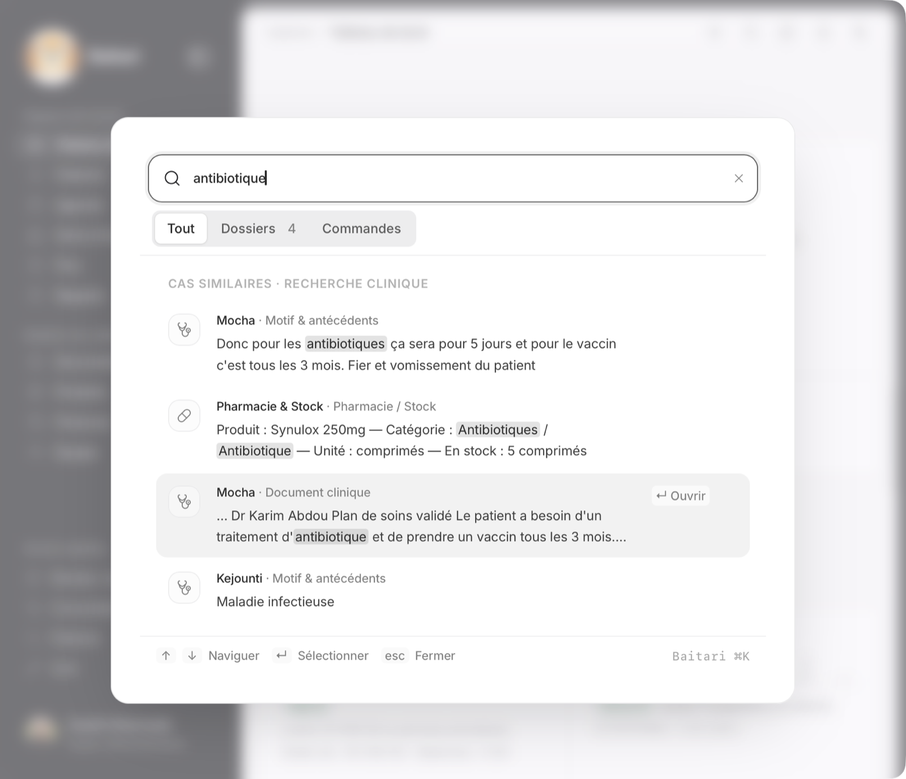
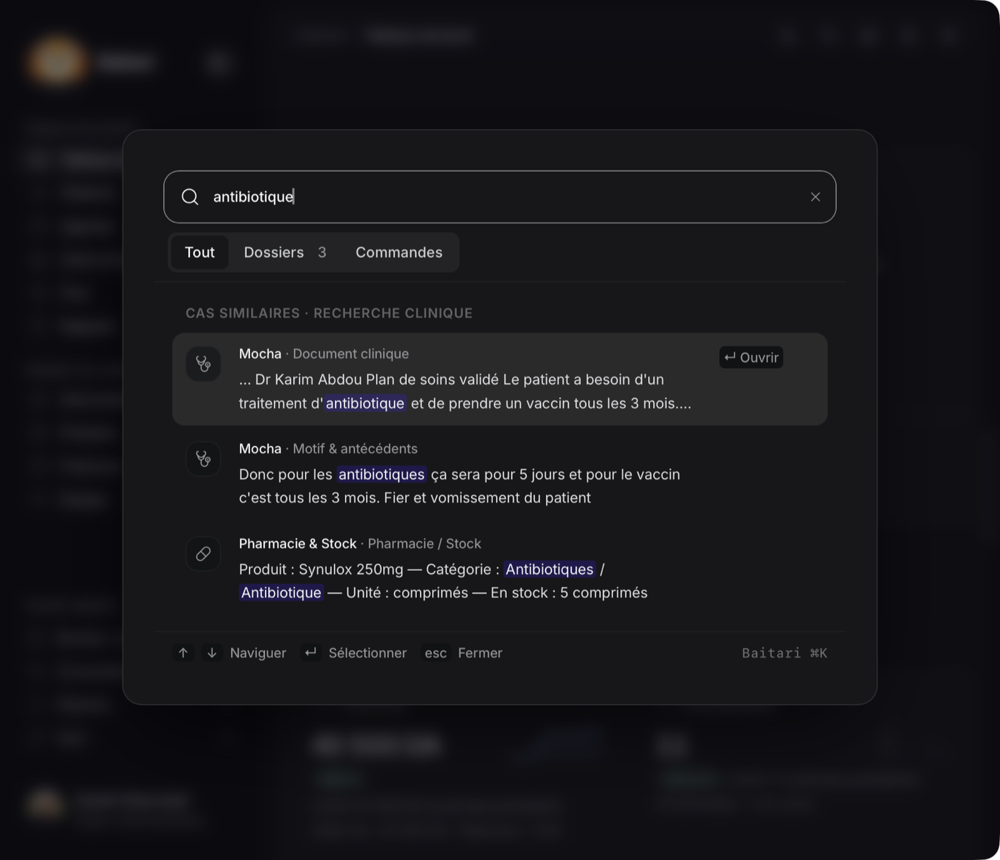
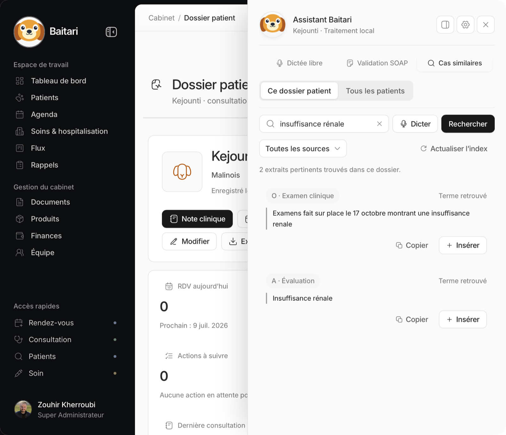
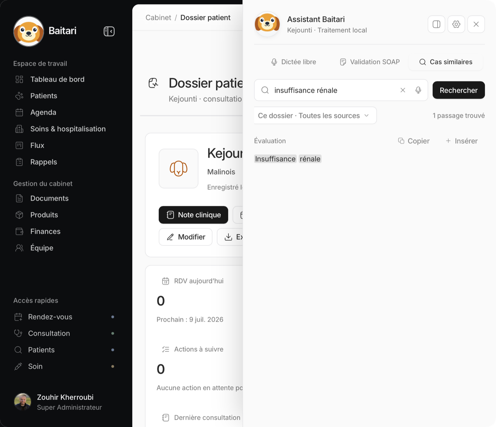
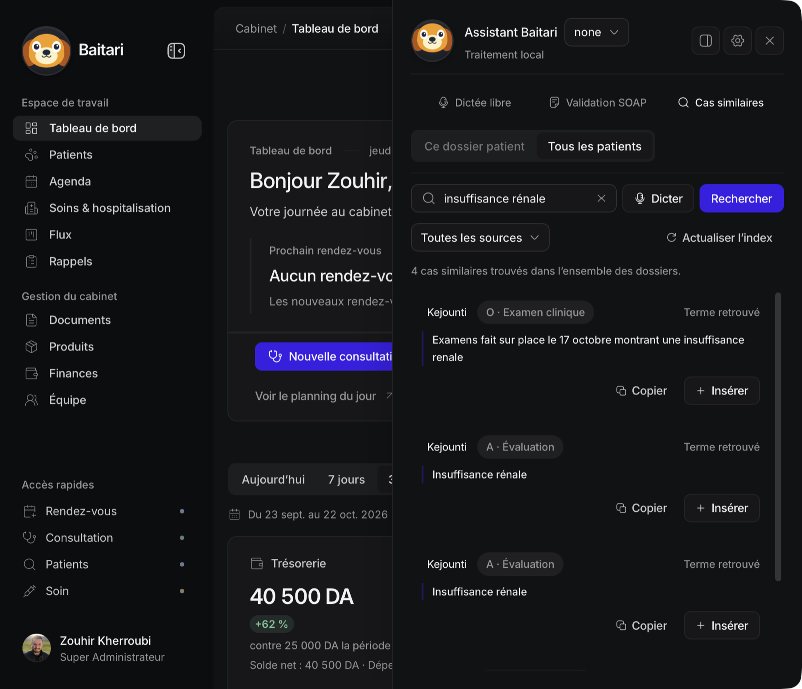
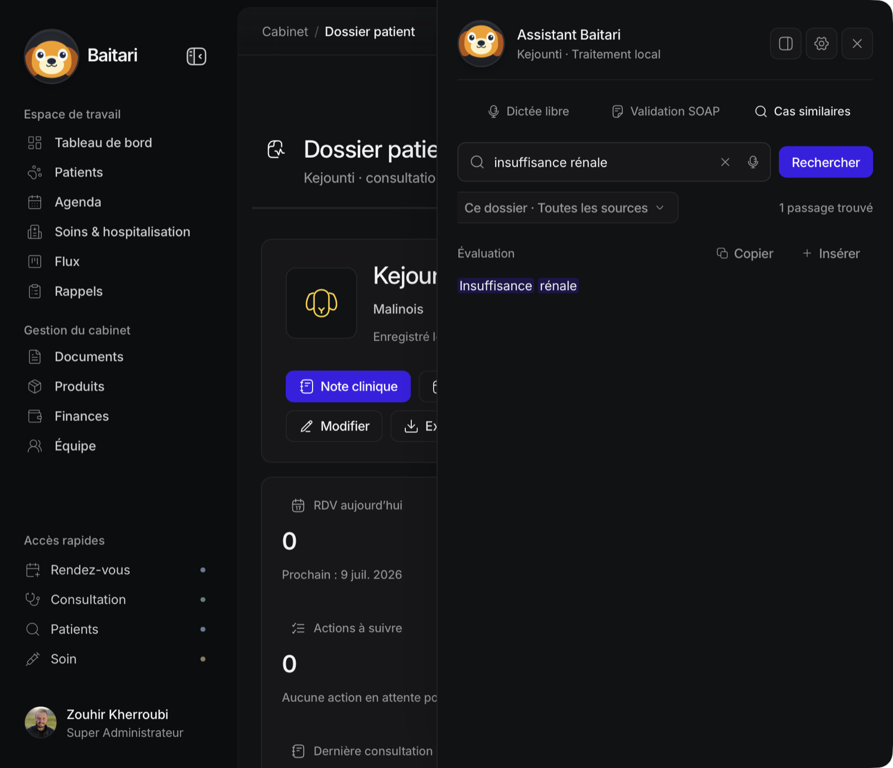

# Phase A1 : classement et découpage de la recherche (22-23 octobre 2026)

Étape A1 du [verdict du challenge](../challenge-recherche/README.md), validée par toi. **Aucun changement de modèle** : EmbeddingGemma v1 fp32 reste en place, A2 n'est pas commencée. Aucun push.

## Verdict : un critère n'est pas atteint, l'index n'est pas basculé

| Critère | Exigé | Mesuré (vrai moteur, WKWebView, M1 8 Go) | État |
|---|---|---|---|
| Alloprof extraits : Rappel@5 | ≥ 78,5 % | **56 %** (actuel : 52 %) | **non atteint** |
| Alloprof extraits : MRR@10 | ≥ 61,1 | **46,4** (actuel : 42,7) | **non atteint** |
| Alloprof : documents refusés | 0 | **0** (actuel : 64 sur 677) | atteint |
| Tes 19 questions validées : aucune régression | 0 régression | **0 régression** ; 17/19 contre 16/19 | atteint |
| Recherches suivantes à chaud | ≈ 0,1 s | 67 à 71 ms sur tes questions ; 138 à 237 ms sur les jeux publics, système en swap de 8 à 10 Go | atteint sur ta base, au-dessus sous forte pression mémoire |
| Comportement de la phase 0 (modèle gardé chargé, verrou rendu) | préservé | tests de la phase 0 verts, inchangés | atteint |

Conformément à ta consigne, **`DEFAULT_SEARCH_GENERATION` reste à `"sections"`**. Je n'ai pas basculé l'index, et **A2 n'est pas commencée**, puisqu'A1 n'est pas fermée. Tout le reste est livré et actif : nouvel écran de recherche, index par extraits construit en parallèle, banc permanent.

### La cause, mesurée : le garde-fou numérique sur des questions chiffrées

Les 78,5 % du verdict avaient été mesurés **sans aucun filtre de sécurité**. L'app, elle, garde le seuil cosinus de 0,30 et le garde-fou numérique (`matchesNumericConstraints`, conservé comme demandé). Or 75 des 200 questions Alloprof contiennent des nombres, souvent des exercices de mathématiques, que les bons passages ne reprennent pas tels quels. Décomposition, sur les mêmes vecteurs que le challenge (EmbeddingGemma v1 fp32, extraits de 800, classement de l'app) :

| Filtres appliqués | Rappel@5 | MRR@10 |
|---|---|---|
| aucun (mode du verdict) | 78,5 % | 61,1 |
| seuil 0,30 seul | 77,0 % | 60,2 |
| garde-fou numérique seul | 58,0 % | 46,9 |
| **seuil + garde-fou (l'app, A1)** | **56,5 %** (le webview mesure 56 %) | **46,1** |
| seuil + garde-fou limité aux doses (quantité avec unité : mg, ml, kg, UI…) | 74,5 % | 58,7 |

La reproduction dans Node (56,5 %) colle à la mesure du webview (56 %) : le banc est fiable. **Le critère comparait un mode sans garde-fou à une app qui en a un.** À filtres égaux, A1 fait mieux que l'actuel sur tout ce qui a été mesuré, sauf le MRR de Syntec (−1,8 point, environ une question sur 100).

### Ta décision

1. **Garder le garde-fou tel quel et rebaser le critère Alloprof** à filtres égaux : 56,5 % et 46,1, qu'A1 atteint (56 %, 46,4). Je bascule alors l'index.
2. **Limiter le garde-fou aux doses**, ce qui est son intention écrite dans le code (« la proximité sémantique ne doit pas confondre les dosages ») : Alloprof monterait à 74,5 % et 58,7. Une date, une durée ou « 3 mois » ne filtreraient plus. Une dose cherchée (« méloxicam 2 mg ») resterait exacte. Cela touche à un garde-fou de sécurité : c'est ta décision, pas la mienne. Il faudrait ensuite rejouer le banc.
3. Ne rien basculer pour l'instant.

## 1. Ce qui a changé

### Moteur de recherche

| Élément | Fichier | Comportement |
|---|---|---|
| Découpage en extraits | `local-ai/passage-search.ts` (`splitPassages`, `passageChunks`) | Extraits d'environ 800 caractères, coupés aux fins de phrase, avec une phrase de chevauchement. Une phrase sans ponctuation plus longue que la limite est coupée aux espaces : **aucun extrait ne peut dépasser la limite du modèle, donc plus aucun refus à l'indexation.** |
| Classement | `rankPassages` | Score = cosinus + **0,05 si le lexique vétérinaire reconnaît la recherche** (bonus, plus de priorité absolue). **Un document vaut son meilleur extrait**, et c'est ce passage qui s'affiche. Un terme exact n'est jamais écarté pour un cosinus faible. Le garde-fou numérique (`matchesNumericConstraints`) est conservé : un passage dont la dose diffère de celle cherchée n'est jamais proposé. |
| Sources sans vecteur | `rankPassages` (paramètre `lexicalOnly`), `searchAllPatientsClinical` | Documents finalisés, fiches patients, consultations et produits restent cherchables par le lexique. Ils entrent au score 0,35, celui d'un résultat sémantique limite confirmé par le lexique, avec leur meilleur passage. |
| Nouvel index en parallèle | `SEARCH_INDEX_KEYS`, `INDEXED_GENERATIONS`, `persistSearchChunks(…, generation)` | Nouveau `model_key` : `embeddinggemma-300m-onnx-fp32-wasm-768-passages800-v3`. Les deux index sont tenus à jour. **Écrire l'un ne supprime jamais les lignes de l'autre** (suppression filtrée par `model_key`). |
| Bascule et retour arrière | `local-ai/search-generation.ts` | La recherche lit l'index **par rubriques** (comportement actuel, intact) tant que la bascule n'est pas faite. Bascule : `setActiveSearchGeneration("passages")`, ou le défaut `DEFAULT_SEARCH_GENERATION` passé à `"passages"` après ta relecture. Retour arrière : `"sections"`, instantané, puisque l'ancien index est toujours là. |
| Gros documents | `embedInBatches` | Un document de plus de 100 extraits part au modèle en plusieurs lots, au lieu d'être refusé par le worker. |

L'index par rubriques (v2) passe toujours par le même code qu'avant (`searchPatientSections`, `mergeLexicalFirst`). Tant que la bascule n'est pas faite, la recherche se comporte exactement comme avant ; seul l'écran change.

### Écran de recherche (traitement Clean)

| Avant | Après |
|---|---|
| **Palette** : 5 onglets (Tout, Patients, Cas similaires, Pages, Actions) | **3 onglets** : Tout, Dossiers (patients, cas cliniques, rendez-vous), Commandes (pages, actions). Rien n'a disparu : chaque catégorie reste visible dans « Tout » et dans son regroupement. |
| Résultats cliniques : icône colorée, badge de rubrique coloré, badge « Similarité 63 % » ou « Correspondance clinique », guillemets, raccourci sur chaque ligne | Une ligne de contexte discrète (patient · rubrique), puis **le passage trouvé, termes surlignés**, centré sur le terme quand il est loin. Le raccourci n'apparaît que sur la ligne sélectionnée. |
| Doublons : la même note de Mocha 3 fois (une par rubrique) | **Un résultat par document**, avec son meilleur passage |
| **Assistant, onglet « Cas similaires »** : onglets Ce dossier / Tous les patients, liste Source, liste Rubrique, bouton « Actualiser l'index », bouton « Dicter » | **Un seul contrôle « Filtres »** qui résume le choix (« Ce dossier · Toutes les sources ») et regroupe périmètre, source, rubrique SOAP et « Actualiser l'index ». La dictée devient une icône dans le champ. |
| Cartes encadrées, badge de rubrique, « Terme retrouvé » ou « 63 % de proximité » | Liste aérée à séparateurs fins : contexte en petit, **passage en avant, termes surlignés**, Copier et Insérer discrets |

Aucune fonction ni source n'a disparu : périmètre, 7 sources, 4 rubriques SOAP, dictée, actualisation de l'index, suggestions, copier, insérer, installation du modèle.

## 2. Captures de l'écran de recherche

Prises dans la fenêtre de debug sur une **copie** de ta base. Avant : code d'origine, index par rubriques. Après : nouvel écran, index par extraits activé pour la capture. Tes réglages locaux ont été restaurés après chaque prise. Palette : recherche « antibiotique » ; assistant : « insuffisance rénale » dans le dossier de Kejounti.

| | Avant | Après |
|---|---|---|
| Palette, clair |  |  |
| Palette, sombre |  |  |
| Assistant, clair |  |  |
| Assistant, sombre |  |  |

Conséquence visible du classement par document : le dossier de Kejounti ne montre plus qu'**un** passage, le meilleur de la note (« Insuffisance rénale »), au lieu des deux rubriques de cette même note. Si tu veux voir aussi les autres passages d'un même document, ce serait une petite mention « + 1 autre passage » à ajouter ; je ne l'ai pas fait.

## 3. Banc avant/après (vrai moteur de l'app)

Un même passage du banc encode les deux index, l'actuel (rubriques) et le nouveau (extraits), et classe chacun avec le vrai code de l'app. Rapports bruts dans [donnees/](donnees/), sans texte clinique.

### Jeux publics en français

| Jeu | Index | Rappel@5 | MRR@10 | nDCG@10 | Refusés | Lignes d'index |
|---|---|---|---|---|---|---|
| PublicHealthQA (85 doc.) | rubriques (avant) | 89 % | 78,4 | 82,0 | 0 | 85 |
| | **extraits 800** | **92 %** | **81,1** | **84,3** | 0 | 178 |
| | extraits 1 200 | 92 % | 82,3 | 85,3 | 0 | 123 |
| Syntec (90 doc.) | rubriques (avant) | 92 % | 81,7 | 85,3 | 0 | 90 |
| | **extraits 800** | **94 %** | 79,9 | 83,9 | 0 | 217 |
| | extraits 1 200 | 93 % | 78,3 | 82,7 | 0 | 146 |
| Alloprof (677 doc.) | rubriques (avant) | 52 % | 42,7 | 45,4 | **64** | 613 |
| | **extraits 800** | **56 %** | **46,4** | **49,6** | **0** | 4 156 |

**800 contre 1 200 caractères** : 800 est retenu. Le 1 200 gagne un peu sur PublicHealthQA (MRR +1,2), perd sur Syntec (MRR −1,6, Rappel@5 −1) et fait jeu égal sur tes questions. Alloprof n'a été mesuré qu'en 800 dans le webview. Le premier passage complet, qui comprenait le 1 200, a échoué au bout de 4 heures (voir Incidents).

### Tes 19 questions validées

| Index | Rappel@5 | MRR@10 | Régressions |
|---|---|---|---|
| rubriques (avant) | 84 % (16/19) | 83,3 | — |
| **extraits 800** | **89 % (17/19)** | **88,9** | **aucune** |
| extraits 1 200 | 89 % (17/19) | 88,9 | aucune |

Le gain vient de « amaigrissement » (synonyme absent du texte). Les deux échecs restants sont communs aux deux index : « diarrhée », alors que le texte dit « diarhée », et « IRC », alors que le texte ne dit pas « chronique ». La question négative ne renvoie rien des deux côtés.

### Mémoire et latence

Pic d'empreinte des processus WebKit pendant le banc : environ 4,8 Go, modèle fp32 chargé et indexation en cours. C'est le même modèle avant et après, donc sans écart attendu ; le gain mémoire viendra d'A2. Requête à chaud, médiane : 67 à 71 ms sur ta base, 138 à 237 ms sur les jeux publics, système en swap de 8 à 10 Go pendant ces mesures.

### Incidents du banc, corrigés

- **Premier passage perdu après 4 heures.** Un lot de 100 documents Alloprof entiers dépassait le délai de 480 s du moteur. Le banc envoie désormais des lots de 10 et **sauvegarde ses résultats après chaque jeu**.
- **Fenêtre masquée = calcul gelé.** macOS met la fenêtre de debug en veille (App Nap) : le calcul tombe à 1 ou 2 % de CPU. Un garde ramène la fenêtre au premier plan quand le calcul retombe (une intervention pendant Alloprof). La contrainte est notée dans le mode d'emploi.

## 4. Mesure A3 : arctic-embed-l-v2 (q8, Apache 2.0)

Menée en parallèle, sans toucher à l'app. La qualité est mesurée dans Node, sur le sous-échantillon Alloprof du challenge, en mode extraits avec bonus lexical. La latence et la mémoire sont mesurées dans le moteur WASM réel (transformers.js 3.8.1, un seul thread, panneau Chromium, M1 8 Go).

| | EmbeddingGemma v1 fp32 (actuel) | arctic-embed-l-v2 q8 | EmbeddingGemma 2 q8 (A2, rappel du challenge) |
|---|---|---|---|
| Alloprof Rappel@5 | **78,5 %** | 76,0 % | 73,5 % |
| Alloprof MRR@10 | 61,1 | **62,8** | 56,0 |
| Alloprof nDCG@10 | 66,8 | **67,9** | 62,0 |
| Disque | 1 261 Mo | 592 Mo | 346 Mo |
| Chargement du modèle (WASM) | 5,7 s | 3,9 s | non mesuré |
| Requête à chaud (WASM) | **85 ms** | 233 ms | non mesuré |
| Encodage d'un extrait d'environ 200 tokens (WASM) | **0,70 s** | 2,12 s | non mesuré |
| Encodage d'un texte d'environ 1 200 tokens (WASM) | 4,6 s | 14,4 s | non mesuré |
| Mémoire en plus pendant l'encodage | ≈ +2,9 Go | ≈ +0,7 à 0,9 Go (ligne de base perturbée par la page précédente) | non mesurée |

**Verdict A3 : arctic n'est pas un gagnant net.**
- **Qualité** : il dépasse nettement EmbeddingGemma 2 q8 (+6,8 points de MRR, +2,5 de Rappel@5). Face à la v1 actuelle, il gagne en MRR (+1,7) et perd en Rappel@5 (−2,5).
- **Vitesse** : il est 2,7 fois plus lent par requête et 3 fois plus lent à l'indexation. Réindexer l'équivalent d'Alloprof (4 171 extraits) prendrait environ 2 h 30 en WASM, contre 50 min.
- **Recommandation** : garder A2 comme prévu, avec EmbeddingGemma 2 q8 (licence permissive, le plus léger), mais **mesurer sa latence WASM dès la preuve de concept d'A2**. Si EmbeddingGemma 2 décevait sur la qualité réelle, arctic serait le repli crédible, au prix de la vitesse.

## Tests

Suite complète : **155 fichiers, 1 206 tests verts** (1 189 au départ), typecheck et ESLint sans erreur. Nouveaux tests (`tests/modules/consultations/passage-search.test.ts`, `embedding-search.test.ts`) :
- **découpage** : fins de phrase, chevauchement d'une phrase, aucun extrait au-delà de la limite même sans ponctuation, numérotation par rubrique, taille de 1 200 ;
- **bonus lexical** : +0,05 sans priorité absolue, départage entre extraits proches, terme exact conservé malgré un cosinus faible ;
- **garde-fou numérique** : un passage à dose différente n'est jamais proposé ;
- **sources sans vecteur**, fusionnées au score lexical seul avec leur meilleur passage ;
- **bascule de `model_key`** : deux index en parallèle (4 + 4 lignes), lecture de l'index actif, réécriture de l'un sans toucher l'autre, retour arrière ;
- **section longue** découpée et indexée au lieu d'être refusée ;
- **surlignage**, élisions comprises (« d'antibiotique »), et aperçu centré sur le terme.

## Ce qui reste

- **Ta décision sur le garde-fou** (voir le verdict) : la bascule (`DEFAULT_SEARCH_GENERATION = "passages"`, une ligne) n'attend plus que ce point. L'ancien index reste en place jusqu'à ta validation finale.
- **A2** démarrera une fois A1 fermée, comme tu l'as demandé : preuve de concept de l'alias transformers.js 4.3.1 d'abord.
- Ton brouillon de questions validé reste hors du dépôt : `~/Library/Caches/baitari-eval/annotations-brouillon.json`.
- Tu peux relancer `npm run tauri:dev`. Le port 5180 est libre.
